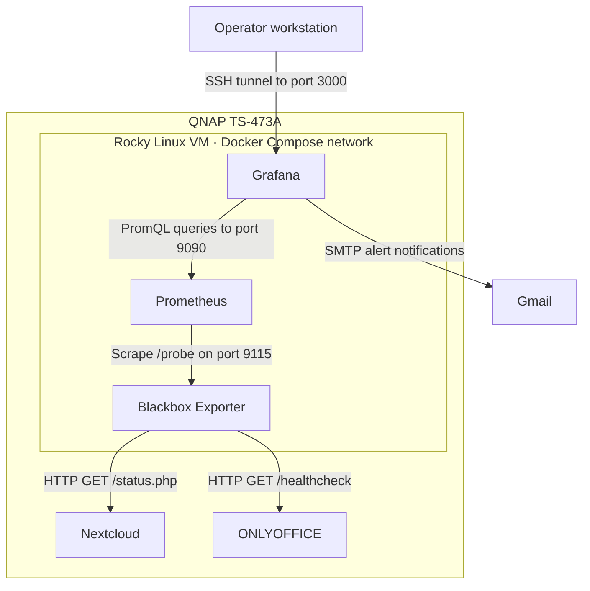

# QNAP monitoring runbook

| Item | Value |
| --- | --- |
| Scope | Nextcloud and ONLYOFFICE availability, Grafana alerting, and email delivery |
| Homelab owner and responder | NAS and monitoring VM operator |
| Monitoring host | Rocky Linux VM running on the QNAP TS-473A |
| Trigger | An availability rule fires, reports **No Data** or **Error**, or the user reports a failed document workflow |
| Related procedures | [Monitoring setup](monitoring.md), [Nextcloud and MariaDB disaster recovery](disaster-recovery.md), [Ansible deployment](monitoring-deployment.md) |

## Architecture



| Component | Configuration or state |
| --- | --- |
| Blackbox Exporter | [Probe modules](../blackbox/blackbox.yml) define how to validate each HTTP response. |
| Prometheus | [Scrape jobs](../prometheus/prometheus.yml) define target URLs and pass each URL to the exporter. Metrics are stored in the `prometheus-data` volume. |
| Grafana | [Provisioning files](../grafana/provisioning/) load the data source, dashboard provider, alert rules, and email contact point. Its database is stored in `grafana-data`. |
| Operator access | Grafana is published on the VM loopback interface. Connect from another host through an SSH tunnel. |
| SMTP | The VM supplies a local environment file. The rule group evaluates every minute and each availability rule has a two-minute pending period. |

The VM and applications share the physical NAS. A full NAS outage can take the monitoring stack offline with the services. To detect an outage at that boundary, the check needs to run from another host.

## Stop and resume monitoring

On the Rocky VM, list the Compose projects, including stopped ones. Use the
project names from the output if they differ from the examples below.

```bash
sudo docker compose ls --all
```

After an isolated test, stop its containers. For continuous monitoring, keep
the main project running.

```bash
sudo docker ps -q --filter 'label=com.docker.compose.project=qnap-monitoring-v1-check' | xargs -r sudo docker stop
```

To pause live monitoring too, stop the main project. Nextcloud and ONLYOFFICE
continue running on the NAS. Metric collection and alert evaluation on the VM
pause until you start monitoring again.

```bash
sudo docker ps -q --filter 'label=com.docker.compose.project=qnap-monitoring' | xargs -r sudo docker stop
sudo docker compose ls --all
```

Look for `exited` on each project you stopped. The named volumes retain the
Grafana database and Prometheus history. On the Ubuntu workstation, press
**Ctrl+C** in the terminal running the SSH tunnel to close it.

To resume the main project on Rocky, start its existing containers. Once
Grafana has started, check that its health response reports `"database": "ok"`.

```bash
sudo docker ps -aq --filter 'label=com.docker.compose.project=qnap-monitoring' | xargs -r sudo docker start
sudo docker compose ls --all
curl -fsS http://127.0.0.1:3000/api/health
```

Reopen the [SSH tunnel](monitoring.md#start-with-a-clean-grafana-database) on
the workstation when you want to view Grafana again.

## Triage

1. Record the timestamp, affected service, Grafana rule state, endpoint, and user-visible symptom.
2. Open **Grafana → Alerting → Alert rules → QNAP → qnap-services**. Inspect the evaluation and the affected instance.
3. In **Explore**, select **Prometheus** and run the two instant queries.

```promql
probe_success{job=~"nextcloud|onlyoffice"}
up{job=~"nextcloud|onlyoffice"}
```

| Signal | Interpretation | Next check |
| --- | --- | --- |
| `up = 1`, `probe_success = 0` | Prometheus collected a valid probe result and the endpoint failed a probe condition. | Check the application response, QNAP container status, and exporter-to-target connectivity. |
| `up = 0` | Prometheus could not scrape the probe endpoint. | Check Blackbox Exporter startup, its config, and the Compose network. |
| **No Data** / **Error** | Grafana had no series to evaluate or its query failed. | Check the Prometheus data source, job labels, and the most recent scrape. |
| **Firing** with no email | Grafana evaluated the condition and email delivery needs investigation. | Confirm the rule uses `qnap-email`, then check the contact point delivery status and Grafana logs. |
| `probe_success = 1` with a user report | The HTTP health checks passed. The document workflow can still fail. | Open, edit, save, and reopen a disposable document through Nextcloud and ONLYOFFICE. |

## Inspect and recover

Run these commands on the Rocky Linux VM from the repository root using the same project and Compose files as the deployed stack.

```bash
monitoring=(
  sudo docker compose
  --env-file "$HOME/.config/qnap-monitoring/grafana-smtp.env"
  -f compose/monitoring.compose.yml
  -f compose/grafana-provisioning.compose.yml
)
"${monitoring[@]}" ps -a
"${monitoring[@]}" logs --since=15m --tail=100   blackbox-exporter prometheus grafana
```

### An application probe fails

1. Check the affected endpoint from the VM with the URL configured for that job.

   ```bash
   curl -sS --max-time 10 -w '\nHTTP %{http_code}\n' '<configured target URL>'
   ```

2. Compare the response with the expected application contract.

   | Check | Expected response |
   | --- | --- |
   | Nextcloud `/status.php` | HTTP 200 and JSON with `installed: true`, `maintenance: false`, and `needsDbUpgrade: false`. |
   | ONLYOFFICE `/healthcheck` | HTTP 200 and body `true`, with optional whitespace. |

3. Inspect the affected service in QTS or Container Station. For Nextcloud, check MariaDB availability and any scheduled maintenance. If the host check passes and the probe fails, inspect the exporter logs and compare the probe URL, module, and recent configuration changes.
4. Once the service is reachable, confirm `up = 1` and `probe_success = 1`. Confirm the Grafana rule returns to **Normal** and validate the document workflow with a disposable file.
5. If data or the database is missing or corrupt, stop this procedure and use the [disaster recovery guide](disaster-recovery.md). Verify the recovery source and destination before writing a restore.

### The monitoring stack fails after a configuration change

1. Record the deployed revision, current Compose status, and the failing service logs. Check disk space on the VM and reachability from the workstation.
2. Validate the Compose and Prometheus configuration from the known-good checkout before restarting an affected container.

   ```bash
   "${monitoring[@]}" config -q &&
   "${monitoring[@]}" run --rm --no-deps --entrypoint /bin/promtool \
     prometheus check config /etc/prometheus/prometheus.yml
   ```

3. Apply the verified configuration or return to the last known-good revision using the same Compose project name and SMTP file. Recreate only the affected service after a bind-mounted configuration change. Use `--no-deps` when the dependency containers are already healthy.

   ```bash
   "${monitoring[@]}" up -d --no-deps --force-recreate blackbox-exporter
   ```

4. Verify Grafana's database status on the VM, then repeat the two queries and check the alert group.

   ```bash
   curl -fsS http://127.0.0.1:3000/api/health
   ```

5. Stop before deleting or replacing a volume, restoring data in place, or applying provisioning to an existing Grafana database with unexplained duplicate UIDs. Verify the intended project, affected state, and recovery source first.

### Grafana fires but email fails

1. Verify that the rule is routed to `qnap-email`. Review the delivery status and recent Grafana logs for SMTP errors.
2. Check the SMTP host and port, sender, recipient, and environment file on the VM. Record error messages with secrets and personal addresses redacted.
3. If the Grafana container's environment changed, apply the same Compose configuration again. On the isolated production-like instance, use the [test-rule procedure](monitoring.md#verify-on-a-separate-compose-project) to confirm receipt.

## Verification evidence

| Check | Observed or expected result |
| --- | --- |
| Live service probes on the Rocky VM | Both jobs returned `probe_success = 1`. |
| Isolated Grafana provisioning | The dashboard, Prometheus data source, two rules, and `qnap-email` loaded from repository files. |
| Gmail delivery from the isolated instance | A temporary `vector(0)` rule entered **Firing** and its email arrived. |
| Nextcloud disaster-recovery exercise | The isolated Nextcloud 34.0.5 and MariaDB restore responded over HTTP. The HBS 3 restore was compared with the working copy using rsync checksums for 82 user files. |
| Reviewer drill | Run the [local demo](reviewer-demo.md) to record fresh **Firing** and **Resolved** messages from both availability rules. |
| Live integration | Use a disposable document to verify open, edit, save, and reopen on your deployment. |

For each incident or drill, record the commit, environment, UTC timestamps for detection and validation, commands, expected and actual results, and follow-up actions. Record RTO from the agreed start time to validated recovery. Measure RPO against the verified recovery point for data restores. The evidence above does not establish an RTO or RPO for the live homelab.

The recovery procedure and evidence fields were informed by the [SteadyOps disaster recovery template](https://github.com/steadyops-best/disaster-recovery-runbook-template).
